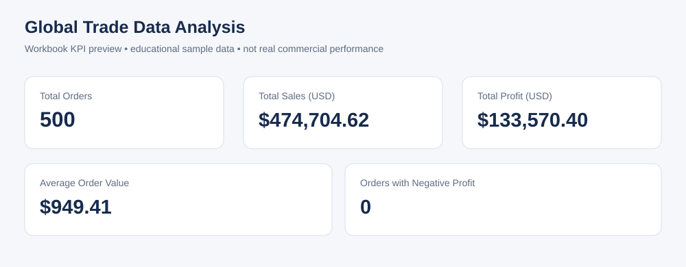

# Global Trade Data Analysis — Excel

## Overview

Excel data-cleaning and summary analysis coursework using trade-order fields such as order dates, countries, products, categories, sales, shipping costs, profit, and region codes. The dataset is an educational sample, not real commercial performance.

## KPI preview

This is a recreated visual preview from the workbook's summary values, not a screenshot of Excel.

| KPI | Value |
|---|---:|
| Total orders | 500 |
| Total sales (USD) | $474,704.62 |
| Total profit (USD) | $133,570.40 |
| Average order value (USD) | $949.41 |
| Orders with negative profit | 0 |

[Download/view the KPI summary CSV](./workbook_kpis.csv)

These figures are copied from the workbook's summary sheet and should be rechecked in Excel or LibreOffice before being used in an interview or presentation. The source summary shows no negative-profit orders, so conditional formatting may be present without any current rows being highlighted.

## Analysis workflow

- Standardize country names and trim extra spaces.
- Convert order dates and format them as month-year.
- Apply currency formatting to unit price, total sales, shipping cost, and profit.
- Highlight negative profits using conditional formatting.
- Use pseudonymous labels if customer fields are included in a public portfolio copy.
- Add KPI formulas and SUMIFS/AVERAGEIFS summaries by Region_Code and Category.
- Validate order IDs and check whether Total_Sales agrees with Quantity × Unit_Price within a rounding tolerance.

## Intended workbook contents

The workbook is expected to contain Raw_Data, Clean_Data, Summary_Tables, and Read_Me sheets.

## File status

The completed Global_Trade_Data_Analysis_Final.xlsx workbook exists in the user's ChatGPT Library but is not currently stored in this GitHub project folder. It still needs to be uploaded as a binary workbook file, along with genuine screenshots of the cleaned data and summary tables. The preview and CSV are useful supporting artifacts but are not substitutes for the workbook itself.

Do not publish customer names or any private data. The public workbook should use the pseudonymous labels from the cleaned version.
