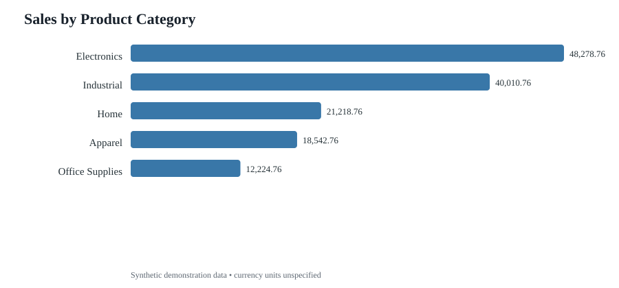
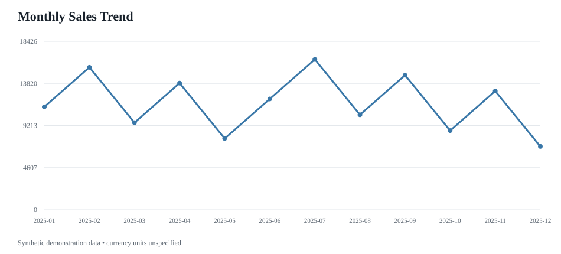

# Supply Chain & Inventory Analytics

An end-to-end beginner portfolio project showing how an analyst can turn order-level data into sales, estimated margin, monthly trend, category performance, and inventory-reorder reporting.

> **Data note:** The CSV contains synthetic demonstration data. It does not represent a real company, supplier, customer, or shipment.

## Verified demonstration snapshot

The committed output snapshot covers 120 synthetic order rows and 20 unique SKUs. These values describe only this demonstration dataset:

| KPI | Value |
|---|---:|
| Order rows / unique orders | 120 |
| Units sold | 1,620 |
| Total sales | 140,275.80 demo currency units |
| Estimated cost | 87,500.24 demo currency units |
| Estimated gross profit | 52,775.56 demo currency units |
| Estimated gross margin | 37.62% |
| Unique SKUs | 20 |

Currency is intentionally unspecified. The figures are not real business performance.

## Charts

## Output files

- [KPI summary](./outputs/kpi_summary.csv)
- [Category summary](./outputs/category_summary.csv)
- [Monthly sales summary](./outputs/monthly_sales.csv)
- [Regional summary](./outputs/region_summary.csv)
- [Warehouse summary](./outputs/warehouse_summary.csv)
- [Inventory reorder alerts](./outputs/inventory_reorder_alerts.csv)

## Business questions

1. What are total sales, estimated cost, gross profit, and gross margin?
2. Which product categories contribute the most sales and estimated profit?
3. How do sales change month to month?
4. Which SKU/warehouse combinations are at or below the reorder point?
5. How do regions and warehouses compare?

## Tools and files

- data/supply_chain_orders.csv — synthetic order/inventory dataset
- analyze_supply_chain.py — data checks, calculations, summaries, and charts
- sql/supply_chain_queries.sql — MySQL 8 query examples
- DATA_DICTIONARY.md — field definitions and limitations
- requirements.txt — Python dependencies
- .github/workflows/supply-chain-check.yml — automated analysis check

## Run locally

From this directory, create and activate a virtual environment, then run:

    python -m venv .venv
    python -m pip install -r requirements.txt
    python analyze_supply_chain.py

On Windows, activate the environment with .venv\\Scripts\\activate. On macOS/Linux, use source .venv/bin/activate.

The script creates an outputs folder containing KPI, category, monthly, regional, warehouse, and reorder CSV summaries plus PNG charts. Outputs are generated locally and are not automatically committed; the CSV and SVG snapshots linked above are committed portfolio outputs.

## Power BI dashboard specification

Import data/supply_chain_orders.csv into Power BI Desktop. Create these visuals:

- KPI cards: Total Sales, Estimated Gross Profit, Estimated Gross Margin %, Unique Orders, Units Sold.
- Line chart: Monthly Sales and Estimated Gross Profit.
- Bar chart: Sales by Category.
- Bar chart: Estimated Gross Profit by Region.
- Table: SKU, Category, Warehouse, Stock On Hand, Reorder Point, Lead Time Days, Reorder Flag.
- Slicers: Order Date, Region, Category, Warehouse.

Suggested DAX measures after importing the CSV as supply_chain_orders:

    Total Sales = SUMX(supply_chain_orders, supply_chain_orders[quantity] * supply_chain_orders[unit_price])
    Estimated Cost = SUMX(supply_chain_orders, supply_chain_orders[quantity] * supply_chain_orders[unit_cost])
    Estimated Gross Profit = [Total Sales] - [Estimated Cost]
    Estimated Gross Margin % = DIVIDE([Estimated Gross Profit], [Total Sales], 0)
    Unique Orders = DISTINCTCOUNT(supply_chain_orders[order_id])
    Units Sold = SUM(supply_chain_orders[quantity])

Save the dashboard as Supply_Chain_Inventory_Dashboard.pbix. The PBIX has not yet been built or added; do not present the SVG previews as Power BI screenshots.

## Metric definitions and limitations

- Sales = quantity × unit price
- Estimated cost = quantity × unit cost
- Estimated gross profit = sales − estimated cost
- Estimated gross margin % = estimated gross profit ÷ sales × 100
- Reorder flag = stock on hand less than or equal to reorder point

The data excludes discounts, taxes, returns, freight, storage, supplier constraints, demand variability, and service-level targets. Inventory values are illustrative snapshots repeated on order rows; real replenishment decisions should use a separate inventory snapshot and consider lead times and demand.

## Validation status

The Python script checks required columns, dates, numeric values, duplicate order IDs, and output generation. Review the GitHub Actions status and inspect generated summaries before reporting exact numeric findings. SQL examples are MySQL 8 style and are still being validated in the added automated MySQL workflow.

## Next improvements

1. Confirm the MySQL 8 workflow passes and compare SQL totals with Python totals.
2. Build and verify the actual Power BI dashboard.
3. Add genuine Power BI screenshots and the PBIX file.
4. Try a licensed public supply-chain dataset for a separate real-world analysis.
